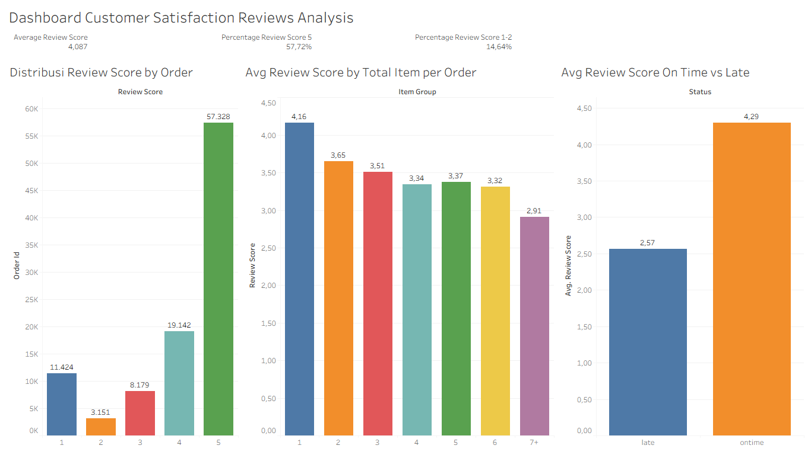

# Olist E-Commerce — Customer Satisfaction and Reviews Analysis

## Project Overview

This project explores customer satisfaction using the Olist Brazilian E-Commerce dataset. The analysis focuses on understanding the overall distribution of review scores, examining the relationship between the number of items in an order and average review scores, and evaluating the correlation between delivery status and customer reviews.

Through this analysis, I aim to understand customer satisfaction patterns and identify aspects of the ordering and delivery experience that may require further evaluation.

## Business Objectives

This project covers three business cases to evaluate customer satisfaction and review patterns.

### Business Case 1: Review Score Distribution

**Objective:** Analyze the overall distribution of review scores from 1 to 5 to understand customer satisfaction levels and identify the most common review scores.

### Business Case 2: Number of Items vs. Average Review Score

**Objective:** Examine whether the number of items purchased in a single order is associated with the average review score to understand how order size relates to customer satisfaction.

### Business Case 3: Delivery Status vs. Review Score

**Objective:** Analyze the correlation between delivery status and review scores to understand whether delivery performance is associated with customer satisfaction, particularly in relation to late deliveries.

## Dataset

This project uses the Olist Brazilian E-Commerce Public Dataset from Kaggle.

**Main Tables Used:**
- `orders_dataset`
- `order_items_dataset`
- `order_reviews_dataset`

**Data Scope:**
- Review score distribution is analyzed using the available review records.
- The number of items per order is calculated using order item data and compared with the average review score.
- Delivery status analysis focuses on orders with `order_status = 'delivered'`.
- Delivery status is determined by comparing the actual delivery date with the estimated delivery date.
- Eight orders with missing actual delivery dates are excluded from the third business case because their delivery status cannot be determined reliably.
- The analysis of review scores by product category is not included because review records cannot be directly linked to individual products using the available review table structure.

## Tools & Technologies

- Python
- Pandas
- NumPy
- Matplotlib
- Seaborn
- Jupyter Notebook
- Tableau

## Analysis Workflow

1. **Import Libraries** — Import Python libraries required for data analysis and visualization.
2. **Data Gathering** — Load the orders, order items, and order reviews datasets.
3. **Data Understanding** — Explore dataset structures, dimensions, column names, data types, and relationships between tables.
4. **Data Quality Assessment & Cleaning** — Check missing values, duplicates, and data inconsistencies, then handle relevant issues for each business case.
5. **Data Preparation** — Merge relevant datasets, calculate the number of items per order, prepare average review scores, and classify delivery status based on actual and estimated delivery dates.
6. **Exploratory Data Analysis (EDA)** — Analyze review score distribution, compare average review scores by order item count, and examine the correlation between delivery status and review score.
7. **Key Insights** — Highlight the main findings related to customer satisfaction, order size, and delivery status.
8. **Business Implications** — Discuss potential areas for improving customer experience based on review patterns and delivery performance.

## Key Findings

### Business Case 1: Review Score Distribution

- Review score 5 was the most common rating, with **57,328 reviews**.
- Review score 4 ranked second, with **19,142 reviews**.
- The distribution shows that high ratings (scores 4–5) dominated the overall review records, indicating that most submitted reviews reflected positive customer experiences.

### Business Case 2: Number of Items vs. Average Review Score

- Orders containing 1 item recorded the highest average review score of **4.16**.
- Average review scores generally decreased as the number of items per order increased, declining from **4.16 for 1-item orders** to approximately **3.32 for 6-item orders**.
- Orders containing 7 or more items had an average review score of **2.63**, but this group consisted of only **57 orders**. Therefore, the result should be interpreted cautiously due to the smaller number of observations.

### Business Case 3: Delivery Status vs. Review Score

- The correlation between delivery status and review score was **0.365064**, indicating a moderate positive correlation based on the interpretation scale used in the notebook.
- Since delivery status is a categorical variable encoded in binary form, the correlation should be interpreted according to its encoding.
- The result indicates an association between delivery status and review score, but it does not establish a causal relationship.

## Dashboard Preview

The dashboard brings together the main findings from this analysis, covering review score distribution, average review scores by the number of items in an order, and the relationship between delivery status and review scores.

### Interactive Dashboard

**[View the Interactive Dashboard on Tableau Public](https://public.tableau.com/app/profile/adin4572/viz/DashboardCustomerSatisfactionReviewsAnalysis/CustomerSatisfactionReviewsAnalysis)**

### Dashboard Screenshot



## Business Implications

- **Maintain positive customer experiences:** The dominance of review scores 4–5 highlights the importance of maintaining consistent product quality, service, and order fulfillment processes to support positive customer experiences.
- **Pay attention to delayed orders:** The observed relationship between delivery status and review scores suggests that delivery performance is worth monitoring as part of customer satisfaction evaluation, particularly for orders experiencing delays.
- **Evaluate customer experiences for larger orders:** The declining average review score as the number of items increases may indicate areas worth reviewing in more complex orders, such as order fulfillment, item completeness, and delivery processes.
- **Use review scores to monitor customer experience:** Review scores can serve as one of the indicators for monitoring customer satisfaction and identifying operational areas that may require further evaluation.

## Repository Structure

```text
Olist-Customer-Satisfaction-and-Reviews-Analysis-Olist-Dataset/
├── README.md
├── Customer Satisfaction and Reviews.ipynb
└── Dashboard/
    └── Dashboard_Customer_Satisfaction_and_Reviews.png
```

## Conclusion

This analysis provides an overview of customer satisfaction through review score distribution, the relationship between order item count and average review scores, and the correlation between delivery status and review scores.

The findings show that high review scores dominated the overall distribution. However, average review scores tended to decrease as the number of items in an order increased. The analysis also identified a moderate positive correlation between delivery status and review score, although this relationship does not establish causation.

These findings provide a starting point for monitoring customer satisfaction, evaluating the experience of customers placing larger orders, and reviewing delivery performance as part of the overall customer experience.

## Project Category

**Data Analysis | E-Commerce | Customer Satisfaction & Reviews Analysis**

**Dataset:** Olist Brazilian E-Commerce Public Dataset
